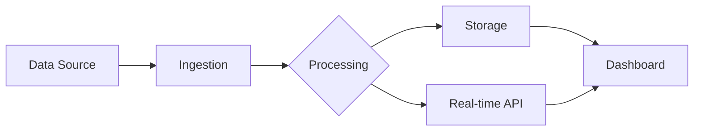

# My Presentation Title

A subtitle for your talk

---

# About This Talk

This presentation demonstrates the features of the **Slidev theme**.

- Bullet points with nested items
  - Sub-item one
  - Sub-item two
- Clean typography
- Responsive layouts

---

# Key Principles

1. Simple and elegant design
2. Developer-friendly workflow
3. Rich feature set
   - Code highlighting
   - Multiple layouts

---
layout: section
---

# Section Break

---
layout: two-cols
---

# Left Column

Content on the left side of a two-column layout.

- First point
- Second point
- Third point

::right::

# Right Column

Content on the right side of a two-column layout.

- Another point
- Yet another point
- One more point

---
layout: two-cols
left-bg: primary
---

# Primary Left

This column has a primary background with white text and shadow.

- Styled automatically
- Independent from right column

::right::

# Normal Right

This column keeps the default styling.

- Standard text color
- Standard background

---
layout: two-cols-header
header-bg: primary
---

# Two Columns Header

::left::

`layout: two-cols-header`
`header-bg: primary`

The header spans both columns with a primary background.

::right::

Content is split into left and right columns below the header.

---
layout: two-cols-header
right-bg: primary
---

# Two Columns Header

::left::

`layout: two-cols-header`
`right-bg: primary`

The right column has a primary background that extends to the edges of the slide.

::right::

This column renders with a **primary background**, rounded top corner and shadow.

- Card-style background
- White text

---
layout: center
---

# Centered Content

**Vue.js** · **Slidev** · **Markdown** · **Vite**

---

# Code Example

```javascript
import { ref, computed } from 'vue'

const count = ref(0)
const doubled = computed(() => count.value * 2)

console.log(`Count: ${count.value}, Doubled: ${doubled.value}`)
```

---

# Mermaid Diagram



---

# Table Example

| Feature | Status |
|---------|--------|
| Slide layouts | Supported |
| Code highlighting | Supported |
| Dark mode | Supported |

---
background: primary
---

# Primary Background

This slide uses `background: primary` to get the primary color background with white text, without changing the layout.

- Works with any layout
- Automatically switches text to white

---
bottom-logo: false
---

# Slide Without Logo

The `bottom-logo: false` frontmatter hides the logo on this slide.

---

# Key Metrics

<div class="grid grid-cols-3 gap-6 mt-12">
  <Kpi label="Active Users" value="12.4k">
    <mdi-account-group />
  </Kpi>
  <Kpi variant="card" label="Datasets" value="847">
    <mdi-database />
  </Kpi>
  <Kpi variant="card-primary" label="Uptime" value="99.9%">
    <mdi-chart-line />
  </Kpi>
</div>

Inline icons also work anywhere: <mdi-rocket-launch /> ready to ship.

---
background: primary
---

# Key Metrics on Primary

<div class="grid grid-cols-3 gap-6 mt-12">
  <Kpi label="Active Users" value="12.4k">
    <mdi-account-group />
  </Kpi>
  <Kpi label="Datasets" value="847">
    <mdi-database />
  </Kpi>
  <Kpi label="Uptime" value="99.9%">
    <mdi-chart-line />
  </Kpi>
</div>

---
layout: two-cols
---

# KPIs in Two Cols

Two KPIs side by side on the left column.

<div class="grid grid-cols-2 gap-4 mt-6">
  <Kpi variant="card" label="Active Users" value="12.4k">
    <mdi-account-group />
  </Kpi>
  <Kpi variant="card" label="Datasets" value="847">
    <mdi-database />
  </Kpi>
</div>

::right::

# Right Column

Two more KPIs side by side.

<div class="grid grid-cols-2 gap-4 mt-6">
  <Kpi variant="card-primary" label="Uptime" value="99.9%">
    <mdi-chart-line />
  </Kpi>
  <Kpi variant="card-primary" label="Queries" value="3.2M">
    <mdi-rocket-launch />
  </Kpi>
</div>

---
layout: end
---

# Thank You!

Questions? Contact us at hello@test.com
